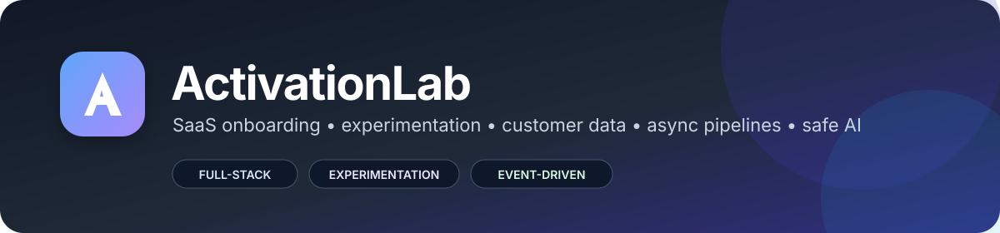
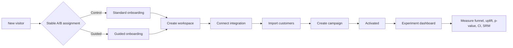
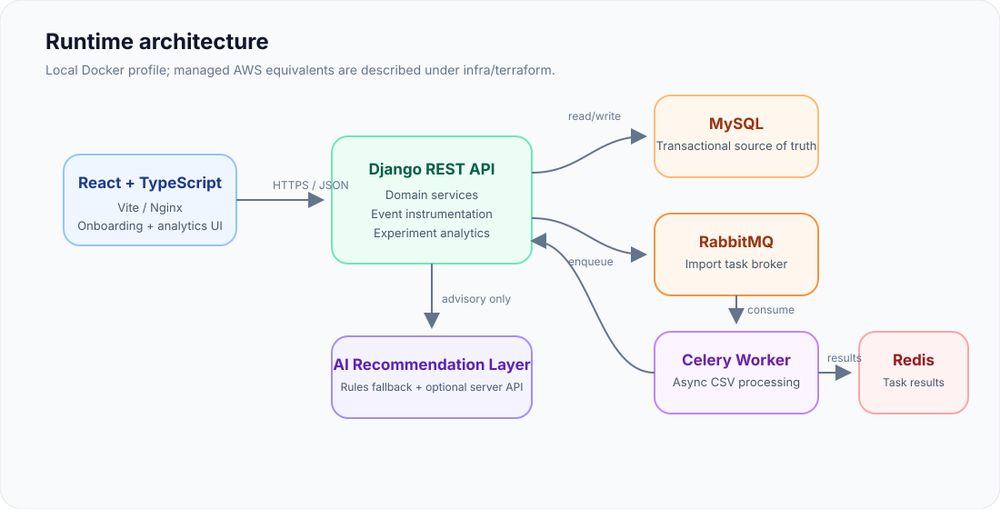
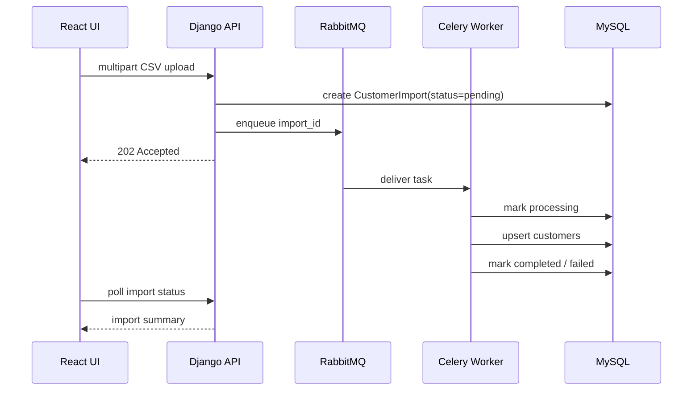

<div align="center">
  

  <br />

  <strong>Production-minded SaaS onboarding, experimentation, customer-data ingestion, and AI-assisted activation.</strong>

  <br /><br />

  
  
  
  
  
  
  
  
  

</div>

---

# ActivationLab

ActivationLab is a full-stack product-engineering project that models the early lifecycle of a SaaS customer: account creation, workspace setup, integration connection, customer-data ingestion, campaign setup, activation measurement, and experimentation.

It is intentionally built around the engineering problems that matter in a modern growth/product platform rather than around a single framework demo:

- customer-facing onboarding UX
- deterministic A/B experimentation
- behavioral event instrumentation
- activation and funnel analytics
- asynchronous data ingestion
- transactional persistence and idempotency
- queue-based background processing
- safe AI-assisted recommendations
- containerized local infrastructure
- production-oriented AWS/Terraform blueprint
- automated tests and CI

> **Important:** seeded experiment data is synthetic and exists only to make the dashboard useful immediately. The repository never presents synthetic uplift as a real business result.

## Product flow



## System architecture

<div align="center">
  
</div>

The repository supports two execution profiles:

### Fast local profile

```text
React + Vite  ->  Django REST API  ->  SQLite
                          |
                          +-> synchronous CSV processing
                          +-> deterministic local copilot
```

Use this when you want the application running quickly with only Python and Node.js installed.

### Full infrastructure profile

```text
React/Nginx -> Django/Gunicorn -> MySQL
                       |
                       +-> RabbitMQ -> Celery worker -> customer import pipeline
                       |                    |
                       |                    +-> Redis result backend
                       |
                       +-> optional server-side AI provider
```

Use this profile to demonstrate queueing, async processing, service health, persistent infrastructure, and a production-style topology.

## Core capabilities

| Area | Implementation |
|---|---|
| Frontend | React, TypeScript, Vite, responsive onboarding UX |
| API | Django REST Framework, serializers, multipart uploads, health endpoints |
| Experimentation | Deterministic 50/50 bucketing, exposure tracking, conversion comparison |
| Statistics | Two-proportion z-test, p-value, 95% CI, uplift, sample-ratio mismatch guardrail |
| Product analytics | Product events, activation funnel, conversion rate, time-to-activation |
| Customer data | CSV ingestion, validation, upsert semantics, customer profiles |
| Async processing | RabbitMQ broker + Celery worker |
| Persistence | MySQL in Docker / SQLite in fast local mode |
| Caching / task state | Redis |
| AI assistance | Rules fallback + optional server-side provider, advisory-only actions |
| Reliability | Idempotent onboarding milestones, health checks, task time limits |
| DevOps | Docker Compose, GitHub Actions CI, Terraform AWS reference architecture |
| Security | Server-side secrets, upload limits, no destructive AI actions, security guidance |

## Quick start — macOS/Linux

### Prerequisites

- Python 3.12+
- Node.js 22+

From the repository root:

```bash
chmod +x setup.sh start.sh scripts/*.sh
./setup.sh
./start.sh
```

Open:

- Frontend: `http://127.0.0.1:5173`
- API health: `http://127.0.0.1:8000/api/health/`
- Django admin: `http://127.0.0.1:8000/admin/`

The setup command creates a virtual environment, installs dependencies, runs migrations, installs frontend packages, and seeds synthetic experiment data.

## Full stack with Docker

Prerequisite: Docker Desktop.

```bash
cp .env.example .env
docker compose up --build
```

Open:

- Application: `http://127.0.0.1:5173`
- RabbitMQ management: `http://127.0.0.1:15672`

Default local RabbitMQ credentials are `guest / guest`.

Reset all service data:

```bash
docker compose down -v
```

## Demo scenario

1. Open the application and note the assigned experiment variant.
2. Create a workspace such as **Northstar Commerce**.
3. Connect the demo ecommerce integration.
4. Upload `sample-data/customers.csv` or use the built-in generated CSV.
5. Create a welcome campaign draft.
6. Confirm the session reaches the activation milestone.
7. Open **Experiments** and inspect conversion, uplift, p-value, confidence interval, SRM, and funnel completion.
8. Open **Copilot** and request an onboarding recommendation.
9. Create a new experiment visitor and verify assignment remains stable for that visitor.

## Activation model

Activation is deliberately modeled as a meaningful product milestone rather than a page view.

A session becomes activated only after all four domain milestones exist:

```text
workspace_created
integration_connected
data_imported
campaign_created
```

When the fourth milestone is completed, the service records `activated_at` and emits one `onboarding_completed` product event containing time-to-activation metadata.

Database uniqueness constraints prevent the same session/step pair from being counted twice.

## A/B experimentation

Variant assignment is stable and reproducible:

```text
SHA-256(visitor_id) -> deterministic bucket -> control | guided
```

Why deterministic assignment matters:

- a visitor cannot randomly switch experiences across refreshes
- repeat requests remain consistent
- experiment contamination is reduced
- behavior can be attributed to the assigned treatment

The dashboard calculates:

- sessions per variant
- activated users per variant
- activation rate
- absolute percentage-point difference
- relative uplift
- pooled two-proportion z-score
- two-sided p-value
- 95% confidence interval
- sample-ratio mismatch check
- funnel completion by variant

See [`docs/EXPERIMENTATION.md`](docs/EXPERIMENTATION.md) for assumptions and interpretation.

## Customer-data import

Expected CSV columns:

```csv
customer_id,email,first_name,last_name,lifetime_value,subscribed,tags
cust-1,ava@example.com,Ava,Shah,420.50,true,vip;repeat
```

At least one of `customer_id`, `external_id`, or `email` must identify the record.

In fast local mode the request is processed synchronously. In the Docker profile:



## Safe onboarding copilot

The copilot is intentionally **advisory**.

Without an external API key, the app uses a deterministic recommendation engine. If a provider key is configured, the backend may use an LLM to produce recommendations, but it still does not grant the model direct capability to:

- send campaigns
- delete customers
- mutate integrations
- execute arbitrary code
- perform destructive actions

The application records the provider and recommendation payload for auditability.

## Testing

Run the project checks:

```bash
./scripts/test-local.sh
```

Backend tests cover:

- deterministic experiment assignment
- signup event instrumentation
- end-to-end onboarding activation
- CSV ingestion and customer creation
- idempotent milestones
- experiment-statistics response shape
- sample-ratio checks
- offline copilot fallback

The frontend check runs the production TypeScript/Vite build.

## Continuous integration

GitHub Actions is configured in `.github/workflows/ci.yml` and executes backend tests and a frontend production build on pushes and pull requests.

## Repository layout

```text
activationlab/
├── .github/                 # CI, Dependabot, issue/PR templates
├── backend/
│   ├── activationlab/       # Django project configuration
│   └── onboarding/          # Product domain, API, analytics, imports, tests
├── frontend/
│   └── src/                 # React/TypeScript application
├── infra/
│   └── terraform/           # AWS production reference architecture
├── docs/                    # Architecture, experiments, security, operations
├── sample-data/             # Demo customer CSV
├── scripts/                 # Local bootstrap/run/test helpers
├── docker-compose.yml
├── Makefile
└── README.md
```

## Engineering documentation

- [Architecture](docs/ARCHITECTURE.md)
- [Experiment design](docs/EXPERIMENTATION.md)
- [API guide](docs/API.md)
- [Security model](docs/SECURITY.md)
- [Operations and failure modes](docs/OPERATIONS.md)
- [AWS/Terraform blueprint](infra/terraform/README.md)
- [Interview deep-dive](INTERVIEW_GUIDE.md)

## Production evolution

This repository is deliberately scoped as a portfolio-grade system, but the architecture has clear production growth paths:

- move uploaded objects to S3 instead of a shared container volume
- add authenticated organizations/users and RBAC
- introduce per-tenant data isolation policies
- use a schema registry for behavioral events
- add retry/dead-letter policies for failed imports
- add OpenTelemetry traces and centralized metrics/logs
- add feature-flag lifecycle management and experiment holdouts
- add real power analysis before launching experiments
- use managed AWS services through the Terraform blueprint
- add zero-downtime migrations and deployment promotion environments

## Ethics of the demo data

`python manage.py seed_demo` creates synthetic sessions and outcomes. They are useful for exercising the product analytics UI but are **not** a production experiment and should never be represented as real conversion improvement.

## License

MIT — see [`LICENSE`](LICENSE).
